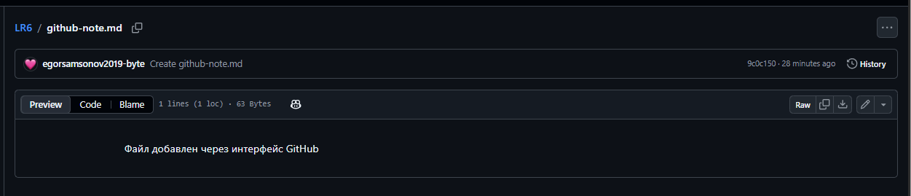
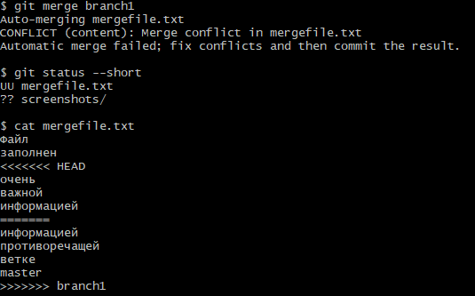
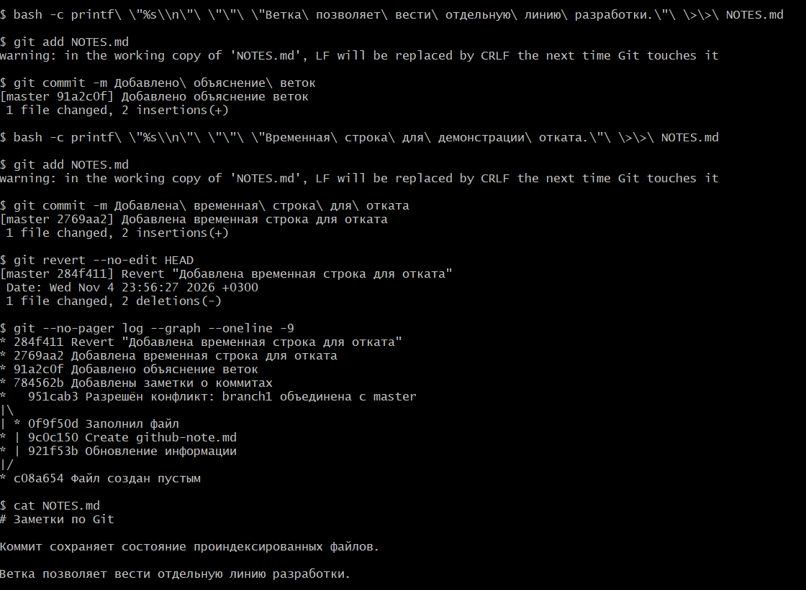
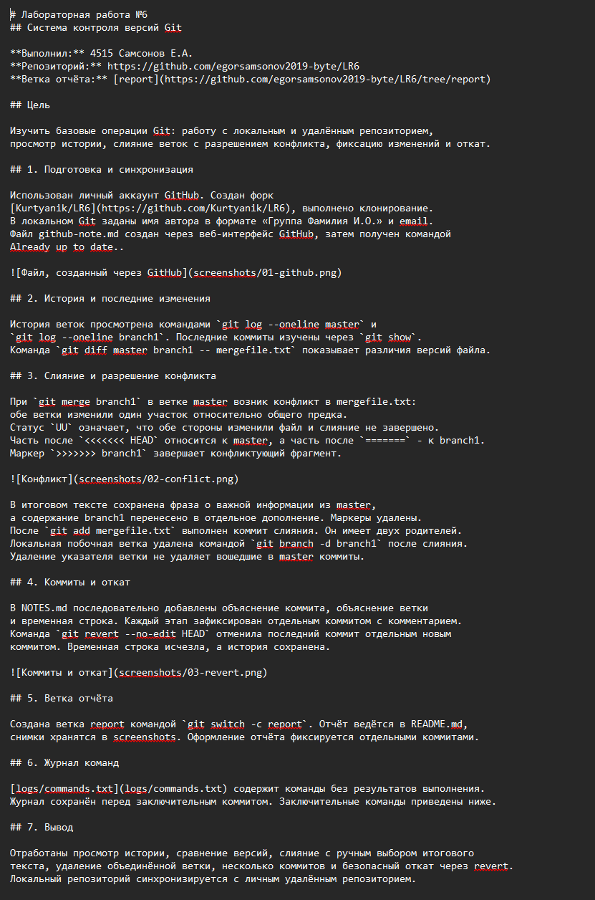

# Лабораторная работа №6
## Система контроля версий Git

**Выполнил:** 4515 Самсонов Е.А.  
**Репозиторий:** https://github.com/egorsamsonov2019-byte/LR6  
**Ветка отчёта:** [report](https://github.com/egorsamsonov2019-byte/LR6/tree/report)

## Цель

Изучить базовые операции Git: работу с локальным и удалённым репозиторием,
просмотр истории, слияние веток с разрешением конфликта, фиксацию изменений и откат.

## 1. Подготовка и синхронизация

Использован личный аккаунт GitHub. Создан форк
[Kurtyanik/LR6](https://github.com/Kurtyanik/LR6), выполнено клонирование.
В локальном Git заданы имя автора в формате «Группа Фамилия И.О.» и email.
Файл github-note.md создан через веб-интерфейс GitHub, затем получен командой
Already up to date..



## 2. История и последние изменения

История веток просмотрена командами `git log --oneline master` и
`git log --oneline branch1`. Последние коммиты изучены через `git show`.
Команда `git diff master branch1 -- mergefile.txt` показывает различия версий файла.

## 3. Слияние и разрешение конфликта

При `git merge branch1` в ветке master возник конфликт в mergefile.txt:
обе ветки изменили один участок относительно общего предка.
Статус `UU` означает, что обе стороны изменили файл и слияние не завершено.
Часть после `<<<<<<< HEAD` относится к master, а часть после `=======` - к branch1.
Маркер `>>>>>>> branch1` завершает конфликтующий фрагмент.



В итоговом тексте сохранена фраза о важной информации из master,
а содержание branch1 перенесено в отдельное дополнение. Маркеры удалены.
После `git add mergefile.txt` выполнен коммит слияния. Он имеет двух родителей.
Локальная побочная ветка удалена командой `git branch -d branch1` после слияния.
Удаление указателя ветки не удаляет вошедшие в master коммиты.

## 4. Коммиты и откат

В NOTES.md последовательно добавлены объяснение коммита, объяснение ветки
и временная строка. Каждый этап зафиксирован отдельным коммитом с комментарием.
Команда `git revert --no-edit HEAD` отменила последний коммит отдельным новым
коммитом. Временная строка исчезла, а история сохранена.



## 5. Ветка отчёта

Создана ветка report командой `git switch -c report`. Отчёт ведётся в README.md,
снимки хранятся в screenshots. Оформление отчёта фиксируется отдельными коммитами.

## 6. Журнал команд

[logs/commands.txt](logs/commands.txt) содержит команды без результатов выполнения.
Журнал сохранён перед заключительным коммитом. Заключительные команды приведены ниже.

## 7. Вывод

Отработаны просмотр истории, сравнение версий, слияние с ручным выбором итогового
текста, удаление объединённой ветки, несколько коммитов и безопасный откат через revert.
Локальный репозиторий синхронизируется с личным удалённым репозиторием.




## 8. Форматированная история

История получена перед заключительным обновлением отчёта.
Формат: хэш | дата | автор | комментарий.

```text
16820b6 | 2026-11-05 | 4515 Самсонов Е.А. | Завершён отчёт: журнал команд и форматированная история
3854430 | 2026-11-05 | 4515 Самсонов Е.А. | Описаны конфликт, слияние и откат; добавлены снимки
a88b6a0 | 2026-11-05 | 4515 Самсонов Е.А. | Начат отчёт: цель и подготовка репозитория
c876ad1 | 2026-11-04 | 4515 Самсонов Е.А. | Revert "Добавлена временная строка для отката"
576584d | 2026-11-04 | 4515 Самсонов Е.А. | Добавлена временная строка для отката
931e6b1 | 2026-11-04 | 4515 Самсонов Е.А. | Добавлено объяснение веток
7d1c0b3 | 2026-11-04 | 4515 Самсонов Е.А. | Добавлены заметки о коммитах
3ddac30 | 2026-11-04 | 4515 Самсонов Е.А. | Разрешён конфликт: branch1 объединена с master
9c0c150 | 2026-11-04 | egorsamsonov2019-byte | Create github-note.md
921f53b | 2020-11-21 | Kurtyanik | Обновление информации
76ba43c | 2020-11-21 | Kurtyanik | Заполнил файл
c08a654 | 2020-11-21 | Kurtyanik | Файл создан пустым
3c6e913 | 2020-11-21 | Kurtyanik | Initial commit
```

## 9. Отправка на GitHub

Ветки master и report отправлены командой `git push -u origin master report`.
